perfcheck documentation
=======================

Repeated measurements vary. ``perfcheck`` turns them into reproducible,
inspectable performance-regression evidence, so you can compare baseline and
current runs consistently under one policy. Keep the observations behind a
decision, investigate changes, and use the same evidence in engineering
investigation and CI gates, rather than relying on a single timing or a bare
statistical-test result. It is an evidence workflow, not a monitoring dashboard.
Its supported public surface is the ``perfcheck`` command-line interface.

From observations to a decision
-------------------------------

A benchmark operator or CI job initiates the workflow. Prometheus supplies
timestamped metric observations; policy configuration provides the suite queries,
eligibility rules, scalar selection, and comparison rules.

#. **Collect evidence.** ``collect`` queries Prometheus for the configured suite
   and time window, saving timestamped observations in one portable raw-run
   artifact. Retaining raw evidence makes the inputs inspectable later.
#. **Summarize each run.** ``summarize`` verifies the raw evidence, checks
   eligibility, and records the selected per-run scalar for each eligible metric
   in a canonical summary. Apply collection and summarization to both cohorts:
   baseline and current.
#. **Compare and act.** ``compare`` evaluates eligible, comparable baseline and
   current evidence under one policy. JSON and Markdown reports explain
   ``PASS``, ``FAIL``, or ``INCONCLUSIVE`` outcomes for an engineer's investigation
   or a CI gate. ``compare`` also accepts raw-run inputs and performs the
   summarization itself; saved summaries are not a required intermediate step.

The stages separate evidence capture from policy evaluation: preserve what was
measured, inspect which runs qualify, and understand why a comparison reached
its outcome. An inconclusive result calls for investigation or more suitable
evidence, not an assumption that performance is unchanged.

Where to start
--------------

Welcome! Start with :doc:`explanation/learning-paths` to choose a beginner,
practitioner, or deep-dive route through the existing guides and executable labs.
For a quick first run, use :doc:`tutorials/first-comparison`; for a complete
artifact-to-CI walkthrough, use :doc:`tutorials/performance-verification-case-study`.
The statistical teaching models explain assumptions without adding CLI methods.

Choose the documentation path that fits your goal.

.. toctree::
   :maxdepth: 1
   :caption: Documentation paths

   tutorials/index
   how-to/index
   reference/index
   explanation/index
