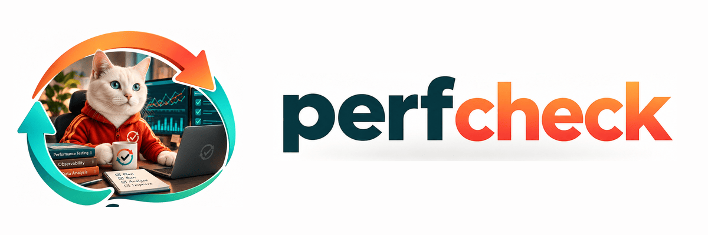

.. rst-class:: homepage

perfcheck
=========

**Welcome to perfcheck!**

Keeping software fast is part of taking care of the people who use it. As a
project grows and changes, performance testing helps us understand whether it is
still as responsive and efficient as we expect.

But understanding a performance change takes more than comparing two numbers.
The same workload can produce different measurements from one run to the next.
When a new version appears slower, is the difference a regression—or simply the
variation we should expect?

**perfcheck helps you investigate that question.** It provides a command-line
workflow for collecting performance measurements, preserving the observations
behind them, and comparing baseline and current runs under a consistent set of
rules. You get reports you can inspect and share, whether you are exploring a
change locally or checking it in CI.

Whether you are new to performance testing or bringing an existing benchmark
into CI, these guides and runnable examples will help you get started.

.. note::

   This documentation is evolving. Some topics may need refinement.

Where to start
--------------

Start with :doc:`explanation/learning-paths` to choose a beginner,
practitioner, or deep-dive route through the existing guides and executable labs.
For a quick first run, use :doc:`tutorials/first-comparison`; for a complete
artifact-to-CI walkthrough, use :doc:`tutorials/performance-verification-case-study`.
The statistical teaching models explain assumptions without adding CLI methods.

Choose the documentation path that fits your goal.

.. toctree::
   :maxdepth: 1
   :caption: Documentation paths

   tutorials/index
   how-to/index
   reference/index
   explanation/index

From observations to a decision
-------------------------------

A benchmark operator or CI job initiates the workflow. Prometheus supplies
timestamped metric observations; policy configuration provides the suite queries,
eligibility rules, scalar selection, and comparison rules.

.. container:: workflow-diagram

    .. mermaid::
       :alt: Evidence workflow: operator or CI feeds Prometheus observations and policy rules for every stage into two parallel cohort pipelines; collect writes raw runs and summarize verifies eligibility and selects per-run scalars, and compare merges the comparable baseline and current summaries into verdict reports, with either cohort's raw runs going directly to compare.

       flowchart TD
           accTitle: perfcheck evidence workflow
           accDescr: A benchmark operator or CI starts collection. Prometheus supplies observations and policy supplies rules for every stage. For both the baseline and current cohorts, collect writes a raw run and summarize verifies eligibility and selects the per-run scalar, producing two parallel summary streams. Compare merges the comparable baseline and current summaries under one policy, and also accepts either cohort's raw runs - performing summarization for those inputs - then produces JSON and Markdown verdict reports for an engineer or CI.
           operator["Benchmark operator / CI"]
           inputs["Prometheus: observations Policy: rules for all stages"]
           subgraph baseline[Baseline cohort]
               cb["perfcheck collect per run"]
               rb["Portable raw runs"]
               sb["Summary"]
           end
           subgraph current[Current cohort]
               cc["perfcheck collect per run"]
               rc["Portable raw runs"]
               sc["Summary"]
           end
           compare["perfcheck compare Comparable evidence + policy"]
           reports["JSON / Markdown reports PASS / FAIL / INCONCLUSIVE"]
           human["Engineer investigation / CI gate"]
           operator --> inputs
           inputs --> cb
           inputs --> cc
           cb --> rb --> sb
           cc --> rc --> sc
           sb --> compare
           sc --> compare
           rb -. "or raw (either cohort)" .-> compare
           rc -. "or raw (either cohort)" .-> compare
           compare --> reports --> human

#. **Collect evidence.** ``collect`` queries Prometheus for the configured suite
   and time window, saving timestamped observations in one portable raw-run
   artifact. Retaining raw evidence makes the inputs inspectable later.
#. **Summarize each run.** ``summarize`` verifies the raw evidence, checks
   eligibility, and records the selected per-run scalar for each eligible metric
   in a canonical summary. Apply collection and summarization to both cohorts:
   baseline and current.
#. **Compare and act.** ``compare`` evaluates eligible, comparable baseline and
   current evidence under one policy. JSON and Markdown reports explain
   ``PASS``, ``FAIL``, or ``INCONCLUSIVE`` outcomes for an engineer's investigation
   or a CI gate. ``compare`` also accepts raw-run inputs and performs the
   summarization itself; saved summaries are not a required intermediate step.

These lanes are the baseline and current cohorts, collected and summarized
independently so their raw runs stay inspectable. ``compare`` reaches its
verdict through a cohort-bootstrap method: it resamples each cohort's eligible
runs to estimate the difference between cohorts under the policy's direction,
then classifies ``PASS``, ``FAIL``, or ``INCONCLUSIVE``.
:doc:`explanation/uncertainty-and-comparison` describes this method, its
uncertainty bounds, and when its assumptions hold. For supplying ``--baseline``
and ``--current`` inputs through ``perfcheck compare``, see
:doc:`how-to/compare-cohorts`.

The stages separate evidence capture from policy evaluation: preserve what was
measured, inspect which runs qualify, and understand why a comparison reached
its outcome. An inconclusive result calls for investigation or more suitable
evidence, not an assumption that performance is unchanged.

Scope
-----

``perfcheck`` is an evidence workflow, not a monitoring dashboard.
Its supported public surface is the ``perfcheck`` command-line interface.
